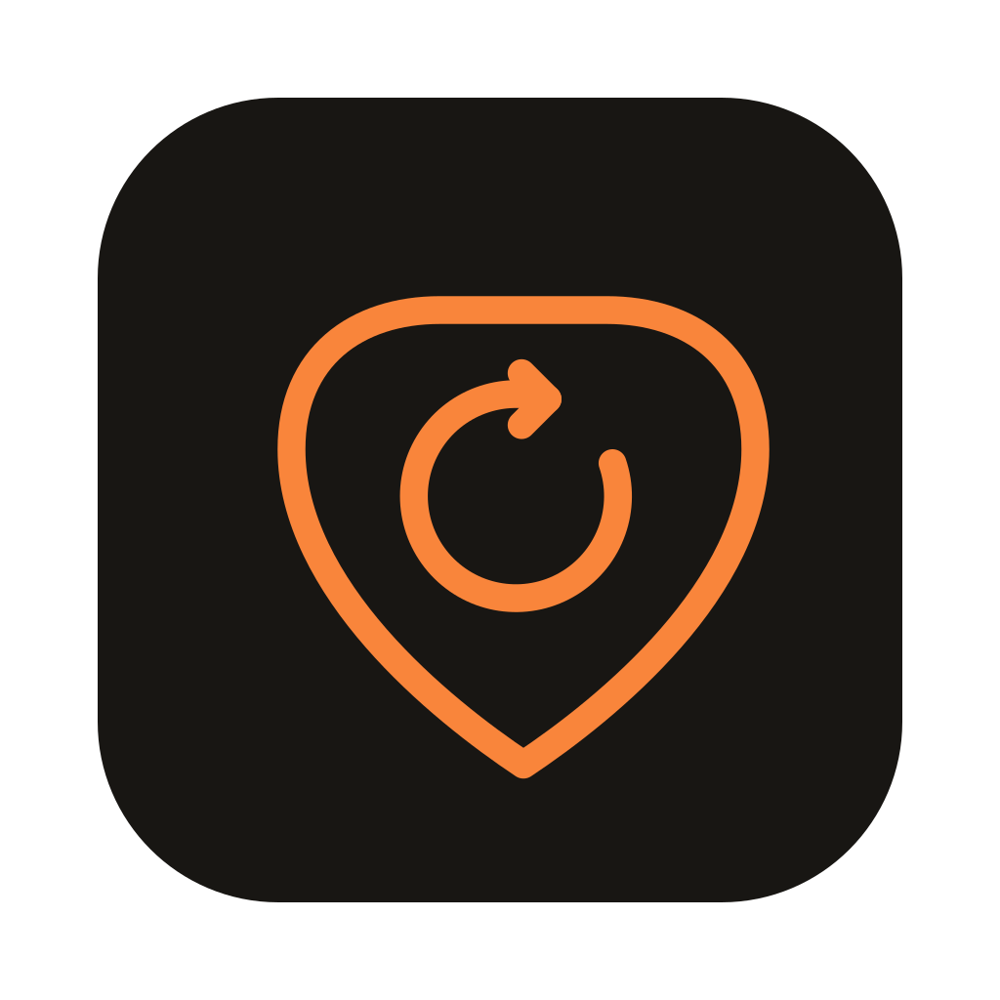

<p align="center">
  
</p>

<h1 align="center">Roadie</h1>

<p align="center">
  <b>Branche-toi. Joue. Sors le clip.</b><br>
  Ampli, looper, caméra synchronisée, montage et export : tout le backstage du guitariste qui filme,<br>
  dans une seule appli. Plus de DAW, d'OBS et de simulateur d'ampli à jongler.
</p>

<p align="center">
  <a href="https://github.com/liamls/roadie/actions/workflows/ci.yml"></a>
  
  
  <a href="LICENSE"></a>
  
</p>

<p align="center">
  <a href="https://github.com/liamls/roadie/releases/latest"><b>Télécharger</b></a> ·
  <a href="#le-parcours-en-cinq-gestes">Le parcours</a> ·
  <a href="#ce-quil-y-a-dans-la-boîte">Fonctions</a> ·
  <a href="#compiler">Compiler</a> ·
  <a href="docs/usage.md">Raccourcis</a> ·
  <a href="ROADMAP.md">Roadmap</a>
</p>

<p align="center">
  
</p>

---

## Le parcours en cinq gestes

1. **Branche-toi.** Choisis une capture d'ampli [NAM](https://www.neuralampmodeler.com) et une réponse d'impulsion de baffle, règle ton son : gain, noise gate, égaliseur, volume. Latence de l'ordre de 10 ms attendue avec une interface audio.
2. **Importe un morceau** (fichier ou lien YouTube) : Roadie détecte le tempo, la première mesure et les parties (Intro, A, B…). Ralentis-le jusqu'à 50 %, transpose-le, boucle une partie.
3. **Joue.** Enregistre une boucle, empile des couches, puis lance une **prise** audio + vidéo après un décompte. La caméra est calée sur le son grâce à une calibration mesurée.
4. **Monte** comme dans GarageBand : déplace, rogne, coupe, duplique les régions, dessine un cycle, annule tout avec ⌘Z.
5. **Sors le clip** : MP4 vertical 9:16 ou horizontal 16:9, titre incrusté, avec ou sans le morceau, ou l'audio seul en WAV.

## Ce qu'il y a dans la boîte

<table>
  <tr>
    <td width="33%" valign="top">
      <h4>🎸 Un vrai ampli</h4>
      Captures NAM (WaveNet, LSTM, Slimmable), égaliseur Grave / Médium / Aigu / Présence, baffle par IR, noise gate, contournement par bloc. Le niveau est normalisé : changer de capture ne fait pas sauter le volume.
    </td>
    <td width="33%" valign="top">
      <h4>🔁 Looper et morceaux</h4>
      Enregistrer → boucler → overdub, annuler une couche, métronome calé sur le transport. Morceaux d'accompagnement MP3 / M4A / WAV / AIFF / FLAC avec tempo et parties détectés.
    </td>
    <td width="33%" valign="top">
      <h4>🎥 Caméra synchronisée</h4>
      Webcam, caméra USB ou iPhone (Continuity Camera). Une calibration de 5 secondes mesure le décalage entre ta carte son et la caméra, appliqué ensuite à chaque prise.
    </td>
  </tr>
  <tr>
    <td width="33%" valign="top">
      <h4>✂️ Montage façon DAW</h4>
      Régions éditables, aimantation à la grille, zone de cycle, zoom, 200 niveaux d'annulation. Deux espaces : <b>Jouer</b> (moniteur, pédale Looper) et <b>Monter</b> (timeline dominante).
    </td>
    <td width="33%" valign="top">
      <h4>🎬 Export en un clic</h4>
      H.264 / AAC avec l'encodeur matériel du Mac, 9:16 ou 16:9, découpe sur la plage voulue, titre incrusté, estimation de la taille avant de lancer.
    </td>
    <td width="33%" valign="top">
      <h4>🛡️ Tes prises sont en sécurité</h4>
      Sauvegarde automatique après chaque modification, copie de secours du projet, prises écrites directement sur disque pendant l'enregistrement. Un projet est un simple dossier lisible dans le Finder.
    </td>
  </tr>
</table>

Interface sombre ou claire, panneaux repliables et redimensionnables, taille de 80 à 125 %, accordeur intégré, vumètres avec témoin de saturation.

## Télécharger

Les versions se trouvent dans l'onglet [Releases](https://github.com/liamls/roadie/releases). Ouvre le `.dmg`, glisse Roadie dans Applications, et autorise la caméra et le micro au premier lancement.

> [!NOTE]
> La bêta est pour l'instant **macOS uniquement** (la caméra et l'export passent par AVFoundation). Le moteur audio et l'interface compilent sous Linux, sans caméra ; Windows n'est pas encore testé. Voir la [roadmap](ROADMAP.md).

> [!WARNING]
> L'import par lien YouTube s'appuie sur [yt-dlp](https://github.com/yt-dlp/yt-dlp), à réserver à un usage personnel : le téléchargement n'est en général pas autorisé par les conditions d'utilisation de YouTube. Les titres d'Apple Music ou de Spotify sont protégés et ne se lisent pas.

## Compiler

```bash
brew install cmake
git clone --recursive https://github.com/liamls/roadie.git
cd roadie
cmake -B build -DCMAKE_BUILD_TYPE=Release
cmake --build build --target Roadie -j
open build/Roadie_artefacts/Release/Roadie.app
```

Les Command Line Tools suffisent (pas besoin de Xcode). **Toujours compiler en `Release`** : en Debug, le moteur NAM sature le CPU. Tests, outils de vérification de l'interface et dépannage : [docs/building.md](docs/building.md).

```bash
cmake --build build --target RoadieLooperTests RoadieDspTests RoadieEngineTests -j
ctest --test-dir build --output-on-failure
```

## Pour aller plus loin

| | |
|---|---|
| [Utilisation et raccourcis](docs/usage.md) | Le parcours complet et tous les raccourcis clavier et souris |
| [Architecture](docs/architecture.md) | Le moteur temps réel, la session, l'interface, et les décisions techniques |
| [Synchro audio / vidéo](docs/sync-audio-video.md) | Comment la guitare et l'image restent calées |
| [Format de projet](docs/project-format.md) | Le dossier `.roadie` |
| [Compiler](docs/building.md) · [Publier une version](docs/releasing.md) | Build, tests, signature, notarisation, DMG, CI |
| [Roadmap](ROADMAP.md) · [Journal des changements](CHANGELOG.md) | Où on en est, ce qui vient |
| [Contribuer](CONTRIBUTING.md) · [Sécurité](SECURITY.md) | Règles du dépôt, signaler une faille |

## Licence

Roadie est publié sous **[AGPLv3](LICENSE)**. Il s'appuie sur [JUCE](https://juce.com) (AGPLv3), [NeuralAmpModelerCore](https://github.com/sdatkinson/NeuralAmpModelerCore) (MIT), Eigen, nlohmann/json et yt-dlp : voir [THIRD_PARTY_NOTICES.md](THIRD_PARTY_NOTICES.md). Les captures `.nam` et les IR ne sont pas fournies ; chacune appartient à son auteur.
