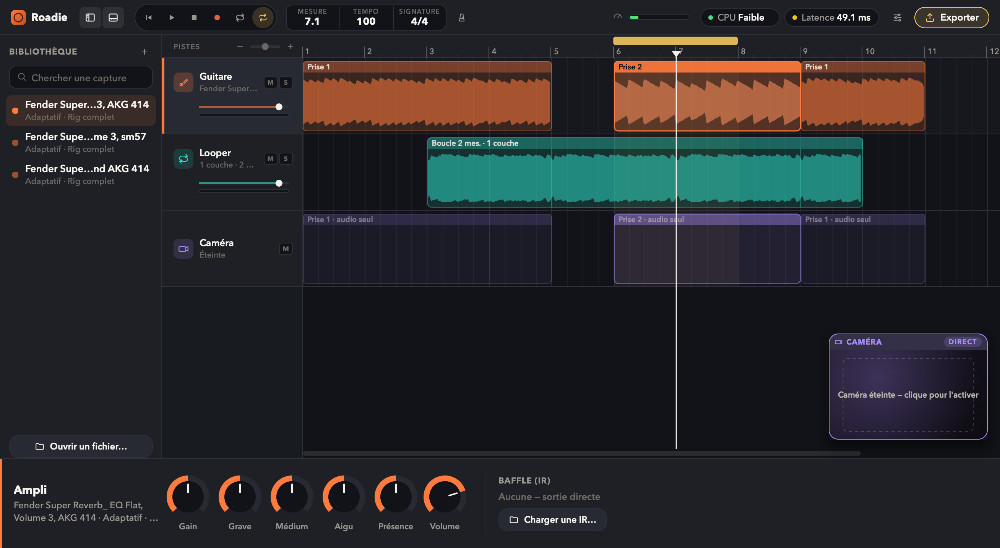

# Roadie

> Appli guitare tout-en-un : ampli basé sur des captures NAM, looper, caméra synchronisée et export de clip — pour filmer, jouer et exporter sans jongler entre un DAW, OBS et un simulateur d'ampli.



Nom provisoire. Ce document existe pour que n'importe quelle machine (ou n'importe quelle session Claude) qui récupère ce dépôt ait tout le contexte nécessaire pour continuer, sans dépendre des notes Obsidian du développeur (qui ne suivent pas le dépôt).

---

## 1. État du projet (30/10/2026)

| Jalon | Statut |
|---|---|
| 0 — Préparation | ✅ Clos |
| 1 — Prototype audio | ✅ Clos (carte son, NAM, IR, latence, CPU) |
| 2 — Maquette design | ✅ Clos (direction visuelle définie, mockup HTML interactif) |
| 3 — Looper | ✅ Clos : looper (enregistrer → boucler → overdub, annuler, effacer), métronome calé sur le transport, **format de projet tranché** (§6) |
| 4 — Webcam + synchro | ✅ Clos sur macOS : capture AVFoundation, aperçu live, prises audio + vidéo, calibration de la synchro (§5). Windows/Linux : pas encore de backend caméra |
| 5 — Export clip | ✅ Clos sur macOS : MP4 H.264/AAC (encodeur matériel), vertical 9:16 ou horizontal 16:9, découpe, titre incrusté, audio seul en WAV |
| 6 — Interface finale | ✅ Clos : interface façon DAW du mockup (bibliothèque, pistes, tête de lecture, moniteur caméra flottant, inspecteur, fenêtre d'export), thème sombre et clair, menus macOS |
| 7 — Montage façon GarageBand | ✅ Fait sur la branche `wip/montage-daw` (pas encore dans `main`) : régions éditables (déplacer, rogner, couper, dupliquer, supprimer, ⌘Z / ⇧⌘Z), zone de cycle, zoom, panneaux repliables et redimensionnables, taille de l'interface, CPU en libellé, survols animés. Reste à vérifier à la main avec une vraie prise filmée : vignettes dans les régions, aperçu LECTURE (§9) |
| 8 — Refonte Jouer / Monter | ✅ Fait sur `wip/montage-daw` : moteur stéréo et compensation de la latence des prises et overdubs ; deux espaces (Jouer : moniteur intégré, pédale Looper, balance ; Monter : timeline dominante, caméra coupée) avec sélecteur, tous les panneaux redimensionnables et repliables ; **morceaux d'accompagnement** (import MP3/M4A/WAV/AIFF/FLAC, tempo et premier temps détectés, parties, ralentir / transposer, export avec ou sans) ; chaîne de signal avec noise gate et contournement par bloc ; piste Master, armement des pistes, faders console, mètres crête + saturation ; décompte ; accordeur ; navigateur Captures / Morceaux / Prises |

Validé sur macOS 15 (MacBook Pro Intel i5-1038NG7, Command Line Tools seules) : build, tests, interface, webcam FaceTime HD, prise de 3 s audio + vidéo puis export MP4 avec la vraie caméra (avant le montage), gestes d'édition de la timeline au robot souris (`--selftest-edit`). **Pas encore testé avec la Scarlett sur ce Mac** (seulement micro et haut-parleurs intégrés, ~49 ms de latence à cause du micro interne ; ~10 ms attendus avec l'interface, comme sur Linux).

---

## 2. Build

### Dépendances

**macOS** (testé sur macOS 15, Intel) : les **Command Line Tools** suffisent (`xcode-select --install`), Xcode n'est pas nécessaire. Plus CMake :
```bash
brew install cmake
```
Sur un Mac Intel sous macOS 15, Homebrew n'a pas de CMake précompilé et le compile depuis les sources (~20 min) : c'est normal, ce n'est pas bloqué.

**Linux** (testé sur Ubuntu 24.04, avant le passage sur Mac) :
```bash
sudo apt-get install -y cmake libasound2-dev libjack-jackd2-dev libcurl4-openssl-dev \
  libfreetype6-dev libx11-dev libxcomposite-dev libxcursor-dev libxext-dev \
  libxinerama-dev libxrandr-dev libxrender-dev libfontconfig-dev libxi-dev
```
La caméra et l'export vidéo y sont désactivés (`Source/Platform_stub.cpp`) ; le reste fonctionne.

**Windows** : Visual Studio 2022 + CMake. Pas encore testé ; même situation que Linux pour la caméra.

### Compiler

```bash
git submodule update --init --recursive   # JUCE + NeuralAmpModelerCore (et leurs sous-modules)
cmake -B build -DCMAKE_BUILD_TYPE=Release
cmake --build build --target Roadie -j
open build/Roadie_artefacts/Release/Roadie.app
```

⚠️ **Toujours compiler en `Release`**. En Debug, le moteur NAM (calcul matriciel Eigen) tourne sans optimisation et sature le CPU — première cause de craquements rencontrée.

⚠️ Si `git submodule update` est interrompu, `libs/NeuralAmpModelerCore` peut rester sur le bon commit mais **sans aucun fichier extrait** (vécu au premier clone sur Mac). Réparer avec :
```bash
git -C libs/NeuralAmpModelerCore checkout -f --detach HEAD && git submodule update --init --recursive
```

**Signature (macOS)** : le build signe l'app en ad hoc (étape post-build). Sans signature, macOS refuse la caméra (et peut refuser le micro) **sans même afficher la demande**. Chaque build ad hoc est une nouvelle identité pour macOS, qui peut redemander les autorisations après une recompilation ; pour l'éviter, signer avec un certificat Apple Development :
```bash
cmake -B build -DROADIE_CODESIGN_IDENTITY="Apple Development: …"
```

### Tests et outils de vérification

```bash
cmake --build build --target RoadieLooperTests RoadieDspTests RoadieEngineTests -j
ctest --test-dir build --output-on-failure
```

| Cible | Ce qu'elle vérifie | JUCE ? |
|---|---|---|
| `RoadieLooperTests` | Looper : record / play / overdub / undo / restart / clear, chargement d'une boucle sauvegardée | non (quelques secondes) |
| `RoadieDspTests` | Égaliseur (courbes), métronome (clics, décompte), détection d'attaque et mesure de décalage de la synchro, libellé CPU, **analyse de morceau** (tempo, premier temps, parties, tap tempo, sur une batterie synthétique), noise gate, accordeur (YIN), étirement temporel et transposition | non |
| `RoadieEngineTests` | Toute la chaîne temps réel via un faux périphérique audio : boucle, mute/solo, pause, overdub, métronome jamais enregistré, prise WAV + horodatage, **compensation de latence** (prise, boucle, saut du décompte), sortie stéréo / mono, Master et gate, **lecture du morceau** en stéréo, entrée de l'accordeur, capture de calibration, une vraie capture NAM (et ses changements en cours de lecture), aller-retour d'un projet avec morceau, **export MP4** 9:16 / 16:9 / plage de la timeline avec titre incrusté (à partir d'une vidéo synthétique) | oui |

Outils :
- `build/RoadieNamBench <capture.nam> <buffer> <sampleRate>` — charge CPU d'une capture (mesures sur ce Mac en §8).
- `Roadie.app --snapshot=/tmp/ui.png [--demo] [--demo-song[=fichier]] [--workspace=play|edit] [--library=captures|songs|takes] [--track=amp|loop|camera|song] [--export] [--light|--dark] [--camera] [--scale=0.9] [--no-library] [--no-inspector]` — rend la fenêtre dans un PNG puis quitte : vérifier l'interface sans capture d'écran (le terminal n'a pas le droit d'enregistrer l'écran). `--demo` ouvre un projet de démo (deux prises synthétiques, une boucle, un cycle) pour voir des régions sans rien filmer ; `--demo-song` y importe un morceau synthétique (batterie et basse à 92 BPM), `--demo-song=/chemin/morceau.m4a` un vrai fichier (chemin sans espace : la ligne de commande est découpée aux espaces). La caméra reste éteinte pendant ces vérifications, sauf avec `--camera`. Lancer via `open -W Roadie.app --args …` pour que les autorisations caméra/micro soient demandées au nom de Roadie.
- `Roadie.app --selftest-edit` — ouvre le projet de démo et le monte comme un utilisateur, avec de **vrais événements souris** injectés dans la fenêtre (toute la chaîne JUCE : zones de prise, seuils de glissement, ⌥, double-clic) : déplacer, rogner les deux bords, dupliquer à ⌥, déplacer la boucle, dessiner un cycle, placer la tête dans la règle, ⌘Z ×4 puis ⇧⌘Z, les séparateurs, Y et B ; puis les espaces (⌘1 / ⌘2, caméra coupée en Monter, chaque séparateur de Jouer, repli et réouverture d'un panneau, tailles mémorisées par espace, panneau agrandi, ● depuis Monter avec son décompte), le morceau (import, tempo, calage sur la mesure 2, lecture, M, clic sur une partie, ×2, décalage et ⌘Z, export avec / sans, 75 % et +2 demi-tons), l'armement, les blocs de l'ampli, le Master et la hauteur d'une piste (60 vérifications, ~40 s). Une ligne par vérification sur stderr ; code de sortie = nombre d'échecs. La fenêtre passe au premier plan (info-bulles coupées) : **ne pas toucher la souris pendant les ~5 s du test**. Le robot partage la souris du système : un vrai mouvement au-dessus de la fenêtre, ou une fenêtre qui passe devant (demande d'autorisation, notification), fait échouer des gestes — relancer dans ce cas. Si la fenêtre n'est pas à l'écran du tout (session verrouillée, écran en veille), le robot remet les gestes directement aux composants (mêmes événements, même ordre) et le signale dans le journal : la logique est vérifiée, pas la distribution par macOS.
- `Roadie.app --selftest-take=/tmp/dossier` — ouvre la caméra, enregistre une prise de 3 s (audio + vidéo) dans un projet créé dans ce dossier, l'exporte en MP4 et affiche le résultat sur stderr. **Filme réellement** : supprimer le dossier ensuite.

Ces outils sauvegardent `Roadie.settings` au démarrage et le remettent en place en quittant : thème, tailles des panneaux, dernier projet ouvert… restent ceux de l'utilisateur.

---

## 3. Architecture

```
Guitare ─► AmpEngine (gain → NAM → égaliseur → IR → volume) ─┬─► direct ──────────────┬─► mix ─► Metronome ─► sortie
                                                             ├─► TakeRecorder (WAV)   │
                                                             └─► Looper ─► boucle ────┤
                         régions des prises (lues à la position du transport) ────────┘
Caméra ─► CameraCapture (AVFoundation) ─► aperçu + prise .mov (H.264), horodatés sur la même horloge que l'audio
```

**Moteur (sans UI)**
- **`AudioEngine`** — enregistré directement comme `AudioIODeviceCallback` (et non via `AudioAppComponent`) pour recevoir l'horodatage hôte de CoreAudio. Orchestre la chaîne ci-dessus et un **transport linéaire** (lecture, stop, placement de la tête, zone de cycle désactivée pendant une prise), avec des blocs découpés aux frontières du cycle et de la région de boucle. Les régions passent au thread audio sans verrou bloquant (en attente → active → retirée) ; la région du dessus l'emporte quand elles se chevauchent. Mute et volume par piste, vumètres, historique de crêtes (pour dessiner ce qui s'enregistre), capture de calibration. Le callback ne bloque jamais : chargement d'une boucle de projet = `SpinLock` côté message, `TryLock` côté audio (un bloc de silence au pire).
- **`AmpEngine`** — capture `.nam` (NeuralAmpModelerCore), normalisation de niveau d'après la loudness de la capture (−18 dB, comme le plugin NAM : changer de capture ne fait pas sauter le volume), `ToneStack`, IR (`juce::dsp::Convolution`), gain/volume. Swap de modèle thread-safe.
- **`ToneStack`** — Grave / Médium / Aigu / Présence (4 biquads RBJ), sans dépendance JUCE.
- **`Looper`** — mono, temps-réel-safe, sans dépendance JUCE. Sortie de boucle séparée du direct (pour mute/solo), compteur de couches, chargement depuis un projet ; la boucle suit la tête de lecture (`setPlayhead`), calée sur son ancre dans la timeline.
- **`Metronome`** — calé sur la position du transport (le 1er temps de la boucle tombe sur le 1er temps de la mesure), premier temps accentué, mixé au monitoring uniquement.
- **`TakeRecorder`** — écrit la guitare amplifiée en WAV via un FIFO sans verrou (`ThreadedWriter`), note l'heure hôte du premier échantillon et la position de la prise sur la timeline.
- **`SyncAnalysis`** — détection d'attaque et calcul du décalage entre deux captures horodatées, sans dépendance JUCE.
- **`CameraCapture`** (`_mac.mm`) — AVFoundation direct : liste des caméras (intégrée, USB, iPhone via Continuity Camera), autorisations, aperçu réduit, enregistrement H.264 via `AVAssetWriter`, vignettes, micro de la caméra pour la calibration.
- **`ClipExporter`** (`_mac.mm`) — composition AVFoundation : le mixage de la plage exportée + la vidéo de chaque région (segments glissés du décalage de synchro, trous en noir), recadrage 9:16 / 16:9, miroir, titre (rendu CoreText), export `AVAssetExportSession` (H.264/AAC, encodeur matériel).
- **`VideoPreview`** (`_mac.mm`) — images de la vidéo sous la tête de lecture (`AVAssetImageGenerator`) pour le moniteur en mode LECTURE ; les requêtes qui s'empilent sont regroupées, les images en retard abandonnées.
- **`CpuLoad`** — la charge CPU audio en mot (Faible / Normal / Élevé) : moyenne glissante sur ~2 s, seuils à 35 % et 70 % avec une bande morte, sans dépendance JUCE.
- **`Project`** — format de projet (§6). **`CaptureLibrary`** — scan des dossiers de captures en arrière-plan, métadonnées des `.nam`.
- **`Session`** — le contrôleur non visuel : périphérique audio (48 kHz / 64 échantillons demandés), projet, prises, transport en secondes, **arrangement** (toute édition passe par `applyEdit` : 200 niveaux d'annulation, protégés quand une nouvelle boucle a été enregistrée entre-temps), sélection, couper / supprimer / dupliquer / insérer une prise, cache audio des prises (crêtes à 100 par seconde), mixage hors ligne (`renderMix`), calibration, export d'une plage, réglages persistants (`~/Library/Application Support/Roadie/Roadie.settings`). L'UI ne parle qu'à elle.

Ajouts de la refonte : **`SongAnalysis`** (tempo par autocorrélation d'une enveloppe d'attaques sur trois bandes puis ajustement d'une grille sur tout le morceau, premier temps par la grosse caisse, parties par nouveauté mesure à mesure), **`TimeStretch`** (WSOLA hors ligne sur les deux canaux à la fois, puis rééchantillonnage pour transposer), **`NoiseGate`** (avant la capture, hystérésis de 6 dB), **`Tuner`** (YIN) — tous sans JUCE. `AudioEngine` mixe en **stéréo** (guitare, boucle et clic au centre, le morceau avec sa stéréo, puis le Master) et place prises, boucles et overdubs une latence aller-retour plus tôt (celle annoncée par l'interface, plus la correction des Réglages audio). Le changement de capture NAM passe par un pointeur rendu au fil principal : plus de bloc sans ampli.

**Interface** (`Source/UI/`) — deux espaces dans une fenêtre, choisis par le sélecteur **Jouer | Monter** en haut à gauche (⌘1 / ⌘2) : `TopBar` (sélecteur, transport, écran mesure/tempo/signature, métronome, accordeur, nom du projet et son état, une pastille latence · CPU qui ouvre les réglages audio, Exporter), `LibraryPanel` (onglets Captures / Morceaux / Prises + recherche), `Monitor` (moniteur intégré : direct avec guides 9:16 / 16:9 et décompte en surimpression en Jouer, lecture seule en Monter), `StagePanel` (Jouer : pédale Looper et balance Morceau / Guitare / Boucle), `Timeline` (bande vidéo en haut, Guitare, Looper, Morceau avec ses parties, Master ; hauteur de chaque piste réglable), `Inspector` (chaîne de signal de l'ampli, Looper, Caméra avec calibration en assistant, Morceau ; empilé et défilant dans la colonne étroite de Monter), `ExportSheet`, `Widgets` (dont `Fader` à courbe de console, `Meter` avec crête et témoin de saturation, `SegmentedControl`, `Splitter` repliable) et `Icons`. `MainComponent` place les panneaux de l'espace courant (tailles par espace, repli, panneau agrandi, transition de 200 ms), coupe la caméra en Monter et route raccourcis, menus et glisser-déposer.

### Organisation du dépôt

| Chemin | Contenu |
|---|---|
| `Source/` | Moteur (sans UI), session, formats ; `Source/UI/` pour les panneaux ; `*_mac.mm` pour AVFoundation, `Platform_stub.cpp` pour les autres systèmes |
| `Tests/` | Tests du looper, du DSP et du moteur ; `TestMovie_mac.mm` fabrique une vidéo synthétique |
| `Tools/` | `nam_bench.cpp`, mesure de charge CPU d'une capture |
| `docs/` | `design-direction.md` (direction visuelle), `reference-ui-garageband-filmcraft.md` (étude d'ergonomie GarageBand / filmcraft), `screenshot.png` |
| `site/` | `index.html`, page de présentation autonome (aucune dépendance au build) |
| `libs/` | Sous-modules JUCE et NeuralAmpModelerCore |

### Sous-modules

- `libs/JUCE` — épinglé sur `9.0.4`. ⚠️ JUCE est sous double licence AGPLv3 / commerciale : une distribution non-AGPL de Roadie nécessitera une licence JUCE commerciale.
- `libs/NeuralAmpModelerCore` — épinglé sur `v0.6.0`. Compilé en bibliothèque **OBJECT** `RoadieNAM` partagée par l'app et les tests (voir §8). Dépendances imbriquées : Eigen, `nlohmann/json`, `AudioDSPTools` (présent mais **pas utilisé** — `juce::dsp::Convolution` pour l'IR).

---

## 4. Utilisation

**Deux espaces.** **Jouer** (⌘1) pour enregistrer : grand moniteur caméra, pédale Looper et balance à droite, la timeline en bande dessous, la chaîne de l'ampli en bas. **Monter** (⌘2) pour éditer : la timeline prend la place, le moniteur et l'inspecteur passent à droite, la caméra est coupée (voyant éteint) et revient avec Jouer. ● depuis Monter repasse dans Jouer et enregistre dès que la caméra est prête.

1. **Ampli** : choisir une capture dans l'onglet Captures (dossiers scannés : `~/Music/Roadie/Captures` et `~/Music`, `+` pour en ajouter ; ou glisser-déposer un `.nam`). La chaîne se lit de gauche à droite : Entrée (gain, noise gate), Capture, EQ, Baffle (IR `.wav`), Sortie ; l'interrupteur d'un bloc le contourne.
2. **Morceau** : glisser un MP3, M4A, WAV, AIFF ou FLAC sur la fenêtre (ou ⌘I, ou l'onglet Morceaux). Roadie le copie dans le projet, détecte son tempo et sa première mesure, règle le tempo du projet, coupe le métronome et cale la première mesure sur la mesure 2 (la 1 sert de décompte). Corriger au besoin dans le panneau Morceau : ×2, ÷2, Taper, ±10 ms, Mesure 2. Un clic sur une partie (Intro, A, B…) la répète en cycle. Pour travailler : −5 % (jusqu'à 50 %) et ±1 demi-ton. Les titres d'Apple Music ou de Spotify sont protégés et ne se lisent pas.
3. **Looper** : la pédale (ou `R`) enregistre, boucle, puis ajoute des couches ; Retirer la couche (`U`), Effacer (`⇧⌫`). Les overdubs sont recalés de la latence.
4. **Caméra** : piste Vidéo → choisir la caméra → Activer. **Calibrer** une fois par combinaison carte son + caméra : un accord étouffé bien sec.
5. **Prise** : ● ou `T` après une mesure de décompte (désactivable dans Transport) ; enregistre les pistes armées (● de Guitare et de Vidéo). La prise est placée là où tu l'as jouée par rapport à ce que tu entendais, et enregistrée immédiatement dans le projet.
6. **Monter** : glisser une région (⌘ libre, ⌥ duplique), tirer ses bords, `⌘T` couper, `⌫` supprimer, clic droit pour le reste ; glisser le morceau le recale (sur sa première mesure). Glisser le haut de la règle dessine un cycle. `⌘Z` / `⇧⌘Z`.
7. **Exporter** (`⌘E`) : plage, format, titre, et **avec le morceau** ou guitare seule → MP4 stéréo dans `exports/` ; ou audio seul en WAV. La taille approximative s'affiche.

**Disposition.** Chaque frontière entre panneaux se tire à la souris (double-clic : taille par défaut) ; tirée sous son minimum, le panneau se replie en laissant une poignée pour le rouvrir. `Y` bibliothèque, `B` inspecteur, `` ` `` agrandit le panneau sous la souris (Échap pour revenir), le bas d'un en-tête de piste règle sa hauteur (⌥⌘↑ / ⌥⌘↓ pour toutes). Chaque espace garde sa disposition ; Affichage › Réinitialiser la disposition. Taille de l'interface de 80 à 125 %.

---

## 5. Synchro audio / vidéo

- La guitare passe par la carte son, l'image par la webcam : deux horloges, deux latences. Roadie horodate chaque bloc audio avec l'horodatage hôte de CoreAudio (`hostTimeNs`, `mach_absolute_time`) et chaque image avec son PTS AVFoundation converti sur la même horloge hôte (`CMSyncConvertTime` depuis l'horloge de session). Le placement de la vidéo dans l'export découle directement de ces deux horodatages (`Take::getVideoOffsetSeconds`).
- Ce que l'estimation ne voit pas (latence réelle des convertisseurs, marge de sécurité CoreAudio) est **mesuré** par la calibration : Roadie écoute 5 s simultanément l'entrée de la carte son et le micro de la caméra (horodaté par AVFoundation comme les images) ; la même attaque entendue des deux côtés donne le décalage (`SyncAnalysis::measureLag`, précision < 1 ms en test). Il est mémorisé et appliqué à chaque prise.
- Un clap n'est pas capté par une entrée guitare (micro de guitare) : d'où la consigne « accord étouffé bien sec », que la carte son reçoit par la guitare et que le micro de la caméra entend acoustiquement.

---

## 6. Format de projet (tranché)

Un projet est un **dossier** `<Nom>.roadie/` (dans `~/Music/Roadie/Projets` par défaut) :

```
Riff du soir.roadie/
├── project.json   tempo, signature, métronome, ampli (capture, IR, potards), caméra, prises, arrangement
├── loop.wav       la boucle, WAV 24 bits mono
├── song/          le morceau d'accompagnement, copié tel qu'importé
├── takes/         take-N.wav (la guitare amplifiée), take-N.mov (la caméra), take-N/ (vignettes)
└── exports/       les clips rendus
```

**Version 2** (montage) : `project.json` porte un objet `arrangement` — les régions (`clips` : prise *par son nom*, `start` sur la timeline, `sourceStart` dans la prise, `length`, en secondes), la place de la boucle (`loopAnchor`, `loopStart`, `loopEnd`, < 0 = jusqu'à la fin), la zone de cycle (`cycleOn`, `cycleStart`, `cycleEnd`) et le volume des pistes en dB. Un projet en version 1 est migré à l'ouverture : ses prises sont posées bout à bout, chacune calée sur une mesure.

Ajouts compatibles (les anciens projets s'ouvrent tels quels) : `song` (fichier dans `song/`, titre, tempo détecté et retenu, `firstDownbeat`, durée, parties, vitesse, transposition, volume), `arrangement.songStart` (annulable par ⌘Z), `arrangement.masterVolumeDb`, et dans `amp` la noise gate (`gateOn`, `gateThresholdDb`) et les contournements (`bypassCapture`, `bypassEq`, `bypassCab`).

Pourquoi un dossier : les médias lourds restent hors du JSON, tout reste lisible avec le Finder, et les prises s'écrivent directement à leur place pendant l'enregistrement (rien à copier au moment de sauvegarder). Chemins internes relatifs ; capture et IR en absolu (elles vivent dans la bibliothèque de l'utilisateur). Le projet est sauvegardé automatiquement après chaque prise et à la fermeture ; `⌘S`, `⇧⌘S` (enregistrer sous, copie le dossier), `⌘O`, `⌘N` ; un dossier `.roadie` se rouvre aussi par glisser-déposer.

---

## 7. Contrôles

| Action | Raccourci |
|---|---|
| Lecture / pause | Espace |
| Retour au début | Entrée |
| Tout arrêter | Échap |
| Espace Jouer / Monter | ⌘1 / ⌘2 |
| Looper : enregistrer → boucler → overdub | R |
| Overdub | O |
| Retirer la couche | U |
| Effacer la boucle | Maj + Retour arrière |
| Enregistrer / arrêter une prise (audio + caméra) | T |
| Métronome | M |
| Zone de cycle | C |
| Mesure précédente / suivante | ← / → |
| Couper la région à la tête de lecture | ⌘T |
| Dupliquer / supprimer la région sélectionnée | ⌘D / ⌫ |
| Annuler / rétablir une édition | ⌘Z / ⇧⌘Z |
| Zoom arrière / avant | ⌘← / ⌘→ (ou pincer, ou ⌘ + molette) |
| Bibliothèque / Inspecteur | Y / B |
| Agrandir le panneau sous la souris / revenir | ` / Échap |
| Pistes plus hautes / plus basses | ⌥⌘↑ / ⌥⌘↓ |
| Panneau Ampli / Looper / Caméra / Morceau | 1 / 2 / 3 / 4 |
| Importer un morceau | ⌘I |
| Exporter | ⌘E |
| Nouveau / Ouvrir / Enregistrer / Enregistrer sous | ⌘N / ⌘O / ⌘S / ⇧⌘S |
| Réglages audio | ⌘, |
| Thème : automatique (système, par défaut) / clair / sombre | menu Affichage › Thème ; ⇧⌘L bascule clair ↔ sombre |
| Tempo | glisser sur l'écran Tempo (Maj = fin), double-clic pour saisir |
| Réinitialiser un potard, un fader (0 dB), un séparateur | Double-clic ou ⌥-clic |
| Réglage fin d'un potard ou d'un fader | ⇧ en glissant (et la molette) |
| Éteindre un témoin de saturation | clic sur le mètre |
| Taille de l'interface (80–125 %) | menu Affichage |

À la souris, dans la timeline : glisser une région (⌘ libre, ⌥ duplique), tirer ses bords (curseur ↔) pour la rogner, clic droit pour le menu ; cliquer ou glisser dans la règle place la tête de lecture (calée sur le temps, ⌘ libre) ; glisser dans sa bande du haut dessine, déplace ou étire la zone de cycle, un clic l'active ou la désactive.

---

## 8. Décisions techniques notables

| Décision | Raison |
|---|---|
| Pas de LTO | ~35 min de lien pour un gain marginal (templates Eigen/NAM) ; `-O3` seul suffit |
| `NAM_SAMPLE_FLOAT` | Les buffers JUCE sont en `float` ; sinon NAM travaille en `double` |
| 48 kHz / 64 échantillons demandés au démarrage | Les captures NAM sont entraînées à 48 kHz ; le défaut système (~81 ms sous PipeWire) était la vraie source de latence. Réglable dans Réglages audio |
| NAM en bibliothèque **OBJECT**, pas STATIC | Chaque architecture (WaveNet, LSTM, Slimmable…) s'enregistre via un initialiseur statique que rien ne référence : dans une archive statique, l'éditeur de liens les élimine → « No config parser registered for architecture » (bug attrapé par `RoadieEngineTests`) |
| Découpage défensif dans `AmpEngine::process` / `AudioEngine` | Certains backends (PipeWire en récupération d'xrun) agrandissent les blocs sans `prepareToPlay` ; NAM/Convolution écriraient hors limites (asserts désactivés en Release) |
| Caméra en AVFoundation direct plutôt que `juce::CameraDevice` | JUCE n'enregistre que la vidéo, horodate la prise à l'heure de la *demande* et non de la première image, fait l'aperçu par une `NSView` native (impossible de dessiner par-dessus) et n'a pas de backend Linux |
| Export via AVFoundation plutôt que FFmpeg | Encodeur matériel, rien à embarquer ni à compiler (pas de bottle FFmpeg pour Intel/macOS 15), recadrage et titre dans la même composition |
| Titre rendu en image CoreText, pas `CATextLayer` | `CATextLayer` sort vide via `AVVideoCompositionCoreAnimationTool` sur macOS |
| Interface « une page façon DAW » (mockup) plutôt que la navigation par pages envisagée au départ | Le mockup retenu montre tout à la fois (pistes + inspecteur contextuel) : sélectionner une piste change l'inspecteur et la couleur d'accent |
| Avenir Next (police système macOS) au lieu de Plus Jakarta Sans / Poppins | Même famille (grotesque géométrique chaleureuse), rien à embarquer ni de licence à vérifier ; chiffres tabulaires simulés (`roadie::fonts::drawTabular`) |
| Majuscules des libellés faites à la main (`toUpperFrench`) | `juce::String::toUpperCase()` transforme « è » en « Î » sur macOS |
| `Looper`, `ToneStack`, `Metronome`, `SyncAnalysis` sans JUCE | Testables en quelques secondes avec un simple compilateur |
| Signature ad hoc post-build | macOS refuse la caméra aux apps non signées sans afficher de demande (les binaires Intel ne sont pas signés par l'éditeur de liens) |
| Taille de l'interface par `Desktop::setGlobalScaleFactor` | Tout est dessiné à la main en coordonnées logiques : un seul facteur met tout à l'échelle (menus et info-bulles compris), la fenêtre garde sa taille à l'écran et montre plus de timeline quand on réduit |
| Survols : un `HoverFade` par cible, piloté par `paint`, un seul minuteur partagé | Fondu de ~120 ms sans un `Timer` par contrôle ; le minuteur ne tourne que tant qu'un fondu bouge |
| CPU en mot (Faible / Normal / Élevé) plutôt qu'en pourcentage | Le pourcentage instantané clignotait ; moyenne sur ~2 s et bande morte de ±3 % autour des seuils, le pourcentage reste dans l'info-bulle |
| Autotest des gestes par `ComponentPeer::handleMouseEvent` | Les événements traversent toute la chaîne JUCE comme ceux du système. Deux pièges : le pair travaille en points natifs (multiplier par l'échelle de l'interface) et JUCE lit ⌥ / ⌘ dans `ModifierKeys::currentModifiers`, pas dans l'événement |

Mesures NAM sur ce Mac (i5-1038NG7, `RoadieNamBench`, 48 kHz) : captures Fender « Slimmable » ~17 % d'un cœur à 64 échantillons (19 % à 32, 16 % à 256) ; WaveNet standard ~21 % à 64. Nettement plus que sur le PC Linux (6-8 %), mais le buffer de 64 reste confortable.

---

## 9. Pour la suite

1. **Tester avec la Scarlett sur le Mac** : latence réelle et **compensation** (une prise jouée sur un clic doit tomber sur la grille ; sinon ajuster « Compensation de latence » dans les Réglages audio), calibration de la synchro, prises longues filmées (vignettes, aperçu LECTURE), un vrai morceau (tempo et premier temps détectés, parties, qualité du ralenti), l'accordeur avec une guitare. Puis fusionner `wip/montage-daw` dans `main`.
2. **Morceaux** : un morceau joué sans clic dérive par rapport à la grille fixe (le son reste juste, la grille et le magnétisme non) ; une carte de tempo suivrait. Séparer la guitare du morceau d'origine serait l'outil idéal pour les reprises (gros chantier).
3. **Caméra hors macOS** : backend Media Foundation (Windows) et V4L2/GStreamer (Linux) derrière `CameraCapture` ; export équivalent (Media Foundation / FFmpeg).
4. **Polices de la DA** : embarquer Plus Jakarta Sans + Poppins (OFL) via `juce_add_binary_data` si on veut l'identité exacte du mockup hors macOS.
5. **Distribution** : signature Developer ID + notarisation, et licence JUCE (AGPL ou commerciale).
6. **Idées** : plusieurs boucles / pistes de looper, quantification de la longueur de boucle à la mesure, choix d'une partie de la boucle dans l'export.
